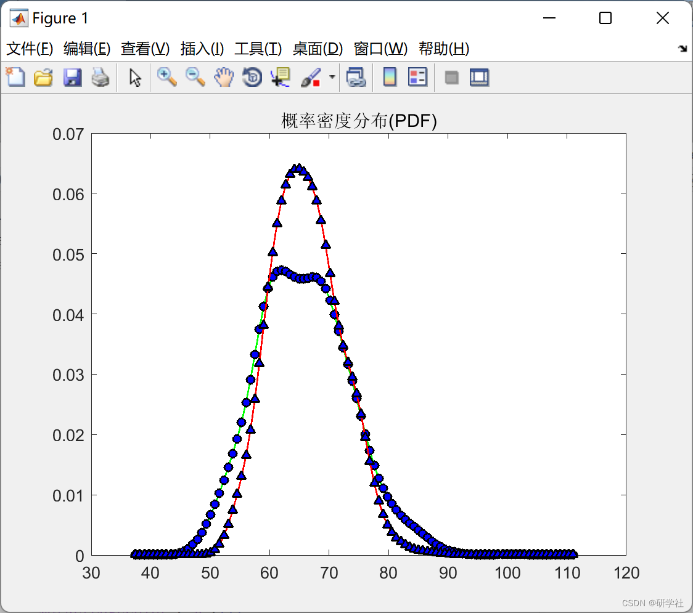
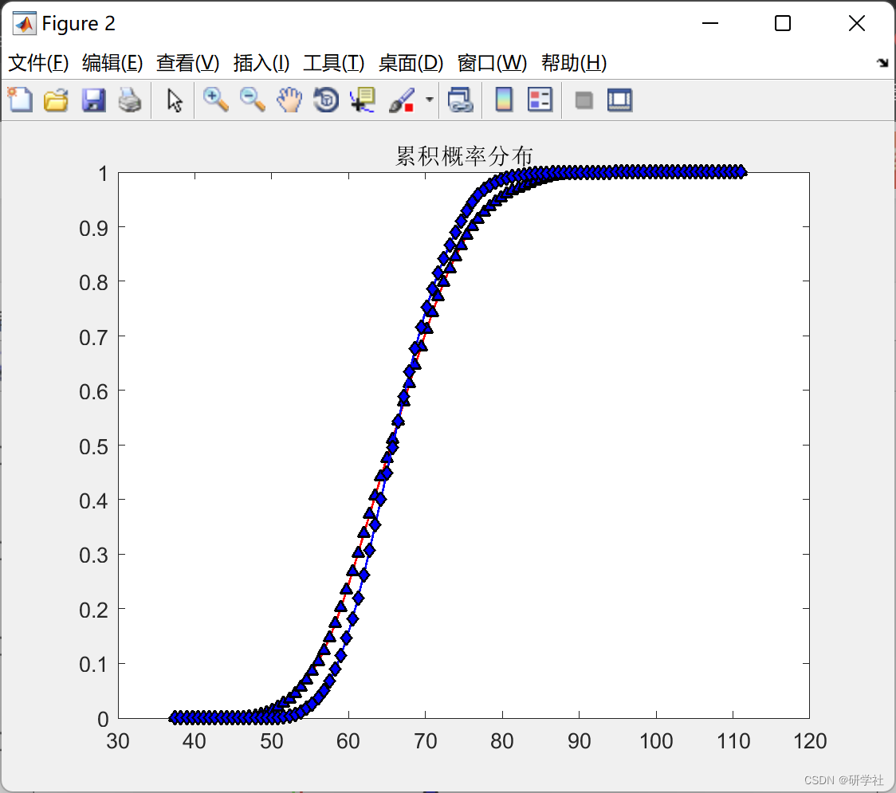

# Cholesky Decomposition (Matlab Code Implementation)

More detailed knowledge points: This blogger explains the material very clearly, excellent: Matrix Cholesky decomposition and its application in solving linear equations and matrix inversion.
📚2 Run results editing
Editing
Part of the code:
for i = 1:N
W3(:,i) = randn(2,1);
end
for i = 1:N
WW3(:,i) = wblrnd(9.0,2.15,2,1);
end
Z3 = R3 * W3;
ccc03 = corrcoef(W3');
ccc03
ccc13 = corrcoef(Z3');
ccc13
aa3 = zeros(2,N);
Ls3 = zeros(2,N);
for p = 1:2
hig = max(Z3(p,:));
k = 1;
for i = 1:N
[b c] = min(Z3(p,:));
Ls3(p,c) = k;
k = k + 1;
Z3(p,c) = hig + 1;
end
end
LLs3 = Ls3;
x = zeros(2,N);
for i = 1:N
tt = (i - 0.5) / N;
x3(1,i) = wblinv(tt,9.0,2.15);
x3(2,i) = wblinv(tt,9.0,2.15);
end
for i = 1:2
y3 = x3(i,:);
bb3 = LLs3(i,:);
hig1 = max(y3);
hig2 = max(bb3);
for p = 1:N
[C1 D1] = min(y3);
[C2 D2] = min(LLs3(i,:));
bb3(1,D2) = C1;
```
y3(1,D1)=hig1+1;  
LLs3(i,D2)=hig2+1;  
end  
yy3(i,:)=bb3;  
end  
🎉3 References
[2] Da Han, Hu Shengbo. Bayesian Compressed Sensing Signal Processing Based on Cholesky Matrix Decomposition [J]. Journal of Guizhou Normal University: Natural Science Edition, 2021, 39(1): 72-76
🌈4 Matlab code implementation

## Images





<!-- PAYMENT_BLOCK -->

## Get this dataset

- Payment link (Stripe): [Buy now](https://buy.stripe.com/3cs8yP7sY87d0vu9AB)
- Payment QR code: 

<!-- /PAYMENT_BLOCK -->
